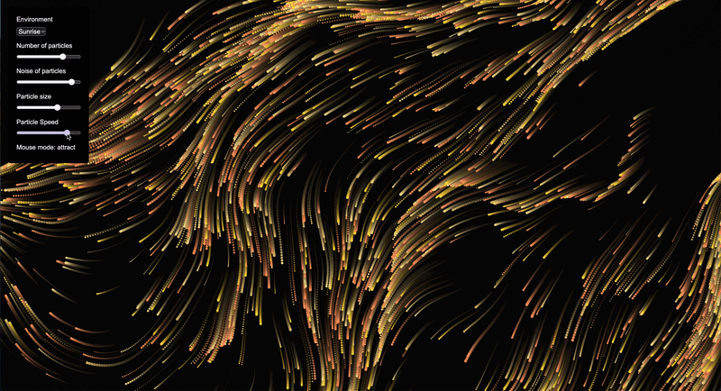
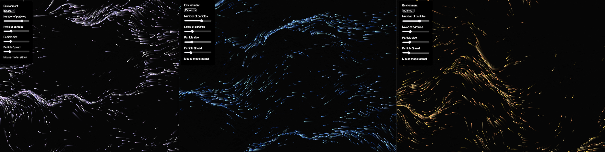
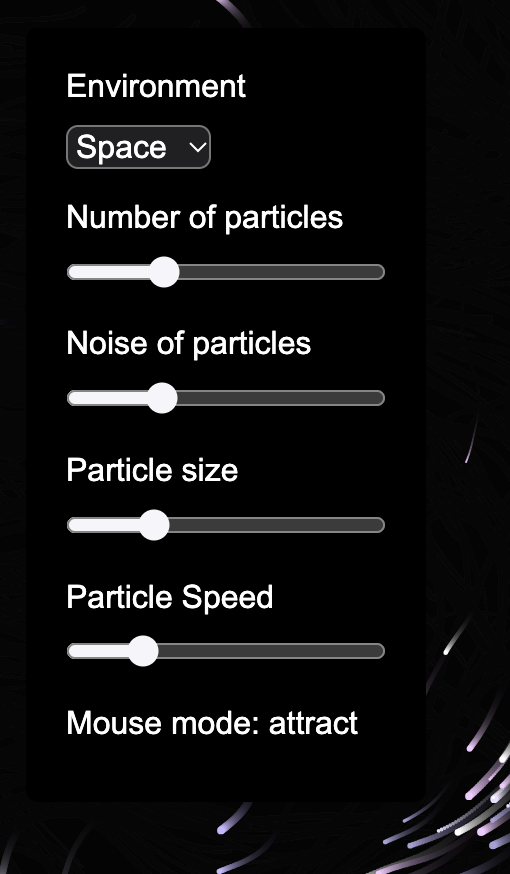
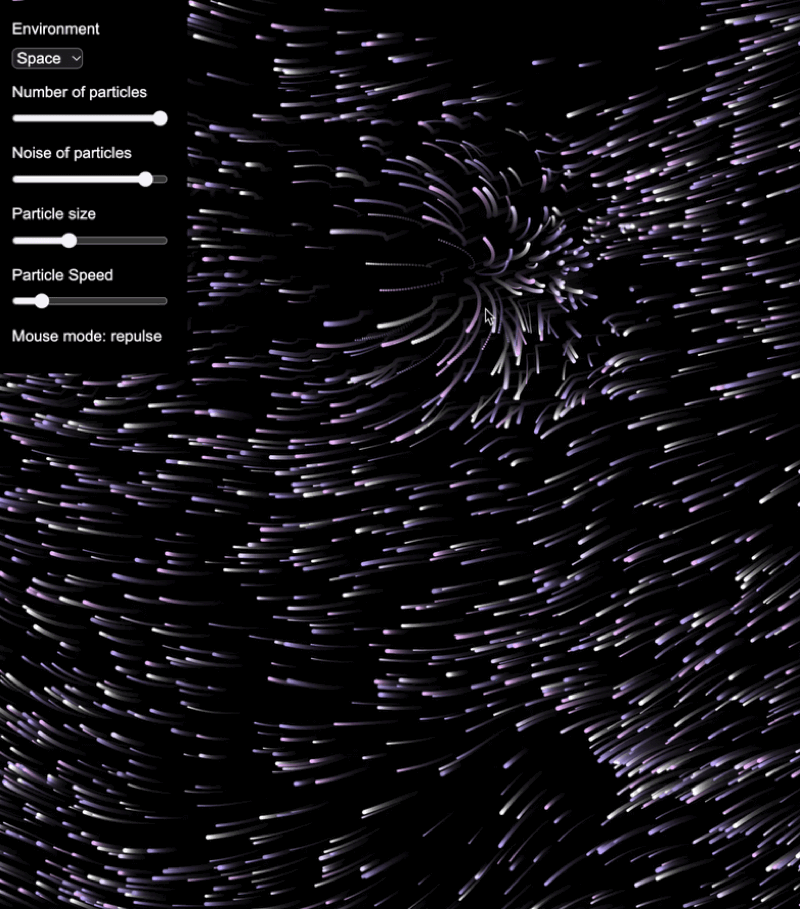

# Final Project - Particle Universe

<!-- Replace "Title" with the name of your project -->

---

### The Project

<!-- What is your project and what does it do?
     What experience does it create, and who or what does it respond to?
     A short paragraph is ideal — make it something you'd be happy for anyone to read. -->
For this final project, I created my own interactive genarative art project using p5.js. The project explores how particle movement, color, and sound can be combined to create an immersive visual experience that users can influence in real time.

The project is based on a flow field system using Perlin noise, which allows particles to move in smooth, organic patterns. Users can interact with the particles using their mouse and customize the visual experience through different controls.

---

### Output



<!-- Drop a screenshot or GIF of your project.
     Got more to show? Add more images — let the work speak for itself.
     Save everything to a readme-assets/ folder inside this project folder. -->

The sound does not work when I screen-recorded my project unfortuanately...
[Watch Online](https://drive.google.com/file/d/14ykd-2WViDiI4ss0OkC28WDwhAH_7yzE/view?usp=sharing)

<!-- Replace the link above with a URL to a screen recording or video of your final project.
     ⚠️ Make sure the file or page is set to public before submitting. -->

---

### ✍️ Reflection

<!-- 200–300 words on your process and outcome. Write freely — this is your story to tell.
     Some prompts to get you started:
     — What did you set out to create, and how did the final result compare to your original vision?
     — How is your project structured — what inputs does it respond to and how did you approach the code?
     — What were your key visual and/or sonic design decisions, and why?
     — What was your biggest challenge, and how did you work through it?
     — What would you change, add, or explore further given more time? -->

**Concept & Intent**

For my final project, I created a Particle Universe sketch, which is an interactive generative art experience. My goal was to create a relaxing and visually engaging environment where users can explore and influence particle movements rather than simply observing an animation.

**Interaction Logic**

The project is based on a flow field using Perlin noise, which generates smooth and organic particle movements. To make the experience interactive, I implemented sliders that allow users to adjust the number of particles, noise, particle size, and speed. I also added mouse attraction and repulsion, where users can influence nearby particles and switch between the two modes by clicking on the canvas.

**Technical Structure**

The code is structured using object-oriented programming through a `Particle` class. Each particle has individual properties, while separate methods handle movement, mouse interaction, edge detection, and rendering. I also implemented a changeEnvironment function to manage different visual and audio settings.

**Behavior Over Time**

The noise field changes over time, while fading trails gradually build up visual patterns. Users can influence these patterns through mouse interactions and sliders.

**Aesthetic Decisions**

For the visual design, I created three environments: Space, Ocean, and Sunrise, each with its own color palette and background music. I chose a consistent black background to emphasize the colorful particles and their movements. The different environments allow users to experience different visual atmospheres while maintaining a cohesive design.

**Iteration & Challenges**

One challenge during development was implementing mouse interaction while ensuring that the sliders and dropdown menu worked independently. I also experimented with particle movement and edge wrapping to create a more continuous flow. Another challenge was getting the background sound to work for each environment, which resulted in creating the `changeEnvironment` function. Through testing and adjustments, I improved the functionality and visual experience of the project.

Overall, this project helped me better understand how object-oriented programming, vectors, and user interactions can be combined to create an engaging interactive visual system.

---

### ✨ Features and Interactions

**Environments**

Users can switch between three different environments using a dropdown menu. Each environment has its own color palette and background music, while maintaining a black background.

- **Space:** White and purple particles inspired by stars and galaxies.
- **Ocean:** Different shades of blue inspired by water and ocean currents.
- **Sunrise:** Warm yellow, orange, and golden particles inspired by sunlight.



**Interactive Controls**

Users can customize the particle system using four sliders:

- **Number of Particles:** Adjusts how many particles are displayed.
- **Noise of Particles:** Changes the variation and flow of particle movement.
- **Particle Size:** Adjusts the size of the particles.
- **Particle Speed:** Controls how quickly the particles move.



**Mouse Interaction**

The mouse can influence nearby particles through two different interaction modes:

- **Attraction:** Particles are drawn toward the mouse cursor.
- **Repulsion:** Particles move away from the mouse cursor.

Clicking on the canvas switches between the two modes. The current mode is displayed in the control panel.



**The Particle Class**

The project uses object-oriented programming through a `Particle` class. Each particle has its own position, direction, speed, size, and color index.

The class contains separate methods for movement, mouse interaction, edge handling, and rendering. Perlin noise is used to generate the flow field, while vectors calculate particle movement and attraction or repulsion forces. The animation evolves continuously over time, and a transparent background creates fading particle trails. When particles leave the canvas, they reappear on the opposite side.

---

### 🔗 References

The original flow field animation was created by **devalladares** and has been used as the starting point for this project.

Original references:

- [Flow Field Animated – p5.js Editor](https://editor.p5js.org/devalladares/sketches/I6lV4tmaP)

The project was further developed with custom color palettes, different environments, background audio, interactive controls, mouse attraction and repulsion, and particle edge wrapping.

---

### 🤖 Use of AI Tools

I used ChatGPT as a learning and debugging tool during the development of this project. It helped me understand programming concepts, troubleshoot errors, and improve parts of my code. For example, I used ChatGPT to help implement mouse attraction and repulsion using vectors and distance calculations. I then adapted the code to fit my project and tested the functionality to better understand how it works.

---

<!-- ─────────────────────────────────────────────────────
     GOING FURTHER — want to document more? Try any of these:

     ### ✨ Features
     A short list of what your project does.
     - Responds to mouse position and velocity
     - Generates sound based on particle density

     ### 🔍 Code Structure
     How are your files organised?
     - `sketch.js` — main setup and draw loop
     - `Agent.js` — autonomous agent class
     - `assets/` — images and sounds

     ### 🛠️ Hardware (if applicable)
     List any physical components used.
     - Arduino Uno
     - Sensor type and model

     ### 🧩 Something I'm Proud Of
     A snippet, a decision, a moment where it all came together.
     ```js
     // your code here
     ```

     ### 🔗 References
     Tutorials, libraries, artworks, or research that informed your project.
     ───────────────────────────────────────────────────── -->
